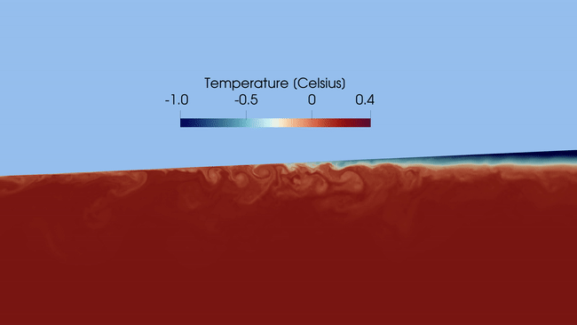
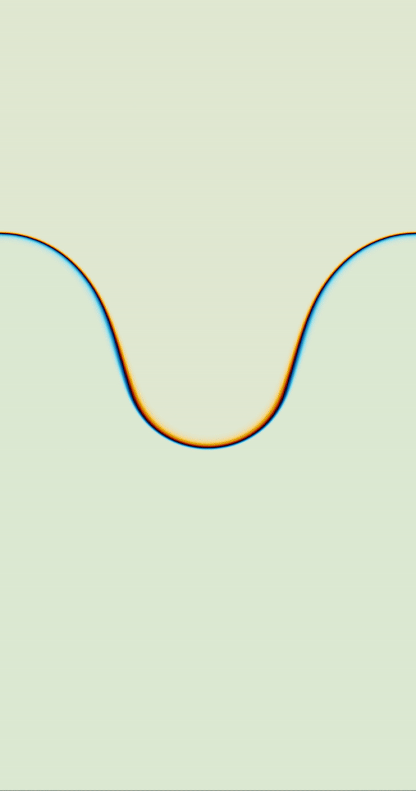
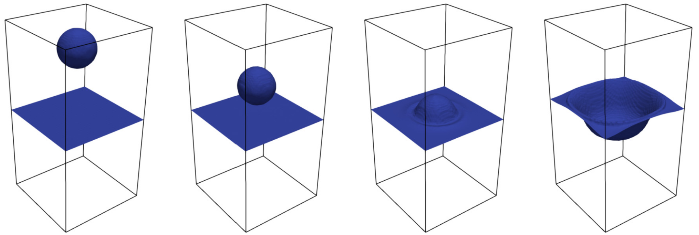

## About

**FEMVarDensFlow** is a finite element library for solving **incompressible, variable density flows**. The software supports a range of buoyancy-driven problems such as **Rayleigh–Taylor instability, falling bubble dynamics, natural convection, stratified flow**, and **ocean circulation beneath ice shelves**. The numerical formulation is based on the **incompressible Navier–Stokes equations with variable density** and the **Boussinesq approximation**, combined with conservative Taylor-Hood finite element discretizations stabilized with residual viscosity and variational multiscale stabilization.

Ocean circulation problems are a central use case, including **ice-ocean interactions and fjord circulation**, but the framework remains general and applicable to non-ocean test cases as well.

FEMVarDensFlow is developed for research, numerical experimentation, and model development. All core components are open source, with a mixture of **MIT-licensed code and LGPL-licensed legacy modules** (see the License section for details).

### Subglacial ocean circulation

### Rayleigh-Taylor instability

### Falling bubble

### Installation

This library requires FEniCS 2019.1.0. See the instructions in the `dardel_help/` folder for installation on the Dardel system at KTH. Adapt those steps to your own environment if installing elsewhere.

## License

This project contains source code under two different licenses:

1. **MIT License**
   Some files written for this project are licensed under the MIT License.
   See `LICENSE` for full terms.

2. **GNU LGPL v2.1**
   Some files originate from earlier work and are licensed under the GNU Lesser General Public License, Version 2.1.
   These files retain their original LGPL notices and remain licensed under LGPL v2.1.
   See `LICENSE_LGPL` for full terms.

### Usage Notes

* MIT-licensed files may be used and redistributed under MIT terms.
* LGPL-licensed files may be used and redistributed under LGPL v2.1 terms.
* MIT code may call or depend on LGPL code without changing the license of the MIT files.
* Modifications to LGPL-licensed files must remain under LGPL v2.1.
* `LICENSE` — MIT License
* `LICENSE_LGPL` — LGPL v2.1 text
* Source files include a header indicating which license applies.

## How to Cite

If you use **FEMVarDensFlow** in your research, please consider citing the related publications:

### Related publications

1. L. Lundgren, C. Helanow, J. Wiskandt, I. Koszalka, J. Ahlkrona, A
potential energy conserving finite element method for turbulent variable density flow: application to glacier-
fjord circulation, Journal of Computational Physics, 2025.

2. L. Lundgren, M. Nazarov, A fully conservative and shift-invariant formulation for Galerkin discretizations of incompressible variable density flow, Journal of Computational Physics, 2024.

3. L. Lundgren, M. Nazarov, A high-order residual-based viscosity finite element method for incompressible variable density flow, Journal of Computational Physics, 2024.

### History

This project originates from the closed-source finite element library FEMCLAW, developed by associate professor Murtazo Nazarov at Uppsala University to solve a variety of conservation laws using continuous finite element methods stabilized with residual viscosity. The contents of the `core/` folder were developed mainly by Murtazo Nazarov and the contents of `varden/` were developed mainly by Lukas Lundgren.